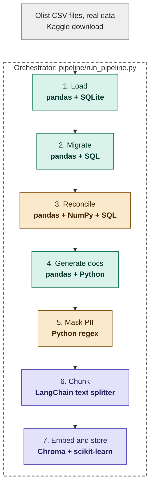
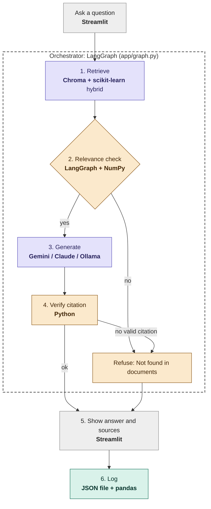

# Migration & Governance Assistant

A retrieval-augmented (RAG) assistant for **data migration and governance**. It migrates a real, open dataset
from a legacy-style extract into a "Data Hub", reconciles the result, generates the governance documents from
the real schema and results, masks PII, indexes the documents, and then answers questions about the migration
**only from those documents, with citations**. If the answer is not in the documents, it says so.

> **Data:** [Olist Brazilian E-Commerce Public Dataset](https://www.kaggle.com/datasets/olistbr/brazilian-ecommerce)
> (Kaggle, CC BY-NC-SA 4.0): 9 CSV files, about 1.55 million rows. The "legacy source" is labelled *Teradata (stand-in)*;
> nothing here uses data from any real company.

## What is real and what is demo design

| Real (computed from the Olist files) | Demo design (written for this project, labelled as such) |
|---|---|
| Row counts, money totals, null rates, key checks | Record layout v2.0 proposal (CHG-001 to CHG-006) |
| Data-quality findings (duplicate ids, missing dates, ...) | Sunset-plan phases, dates and owner roles |
| Source-to-target mapping, types, sample values | The governance policy and runbook (`docs/authored/`) |
| PII tokenization and masking counts | Team and feed names |

## The two workflows

**Workflow 1: ingestion (batch).** A plain Python script orchestrates seven steps. In production the same steps
would be tasks in an Airflow / Cloud Composer DAG.



**Workflow 2: query (every question).** The graph is orchestrated with LangGraph; the relevance check is the branch.



### How retrieval works (hybrid search)

| Method | Library | Good at |
|---|---|---|
| Meaning search | Chroma vector database + a local embedding model | "postal code" finds a passage that says "zip prefix" |
| Keyword search | scikit-learn TF-IDF with stemming | exact field names such as `customer_zip_prefix` |

NumPy blends the two scores (60 % meaning, 40 % keywords). The **relevance score** is the best blended score scaled by the
share of the question's words that appear in the retrieved passages, so a question made of words found nowhere in the
documents ("weather in Dallas") scores low and is refused **before any LLM call**. The refusal threshold is calibrated
automatically at index time from a list of off-topic probe questions (`eval/offtopic_probes.json`). As a second guard, the
LLM is told to answer `NOT_FOUND` when the passages do not contain the answer, and answers without a valid `[S#]` citation are refused.

## Results from the real run

Reconciliation (policy P-05: exact row counts, money within 0.01 %, null drift at most 0.5 pp, key uniqueness preserved):

| Hub table | Rows | Status |
|---|---|---|
| hub_customer | 99,441 | PASS |
| hub_order | 99,441 | PASS |
| hub_order_item | 112,650 | PASS |
| hub_payment | 103,886 | PASS |
| hub_review | 99,224 | PASS |
| hub_product | 32,951 | PASS |
| hub_seller | 3,095 | PASS |
| hub_geolocation | 1,000,163 | PASS |

Data-quality findings that the reconciliation surfaced in the source data (kept, not silently fixed):

| ID | Finding | Count | Blocks cutover |
|---|---|---|---|
| F-01 | Duplicate `review_id` values (excess rows) | 814 | Yes |
| F-02 | Delivered orders with no delivered timestamp | 8 | Yes |
| F-03 | Orders with no order items | 775 | No |
| F-04 | Orders with no payment record | 1 | No |
| F-05 | Products with no category name | 610 | No |
| F-06 | Products whose category has no English translation | 13 | No |

The full pipeline (all 7 steps) runs in about 15 seconds. 96,096 distinct `customer_unique_id` values became 96,096 distinct tokens (0 collisions).

### Evaluation (`python -m eval.run_eval`)

16 test questions (12 answerable, 4 not). The committed `results/eval_results.json` was produced in **no-LLM mode with the
offline embedding fallback**, so it measures retrieval and the refusal gate, not an LLM:

| Metric | Value |
|---|---|
| Retrieval hit rate (right source in the top 4) | 12 of 12 |
| Answer-vs-refuse accuracy (scikit-learn) | 16 of 16 |
| Correct refusals | 4 of 4 |
| Answers containing the expected fact (top 3 passages, no reasoning) | 10 of 12 |

Run `python -m eval.run_eval` with your own Gemini key to measure the full configuration.

## Run it

### Option A: in the browser with GitHub Codespaces (nothing to install)

1. On this repo page: **Code → Codespaces → Create codespace on main**. The first start takes a few minutes: it installs the packages and builds the search index from the committed documents.
2. In the Codespace, copy `.env.example` to `.env` and paste your free Gemini key (from <https://aistudio.google.com>) after `GEMINI_API_KEY=`.
3. Check the setup: `python check_setup.py`
4. Start the app: `streamlit run app/ui.py`, then click **Open in Browser** in the pop-up.

To re-run the whole pipeline instead of using the committed documents, download the Olist zip from Kaggle, drag the CSVs into `data/raw/`, and run `python -m pipeline.run_pipeline`.

### Option B: on your own computer (Windows PowerShell shown)

```powershell
python -m venv .venv
.venv\Scripts\activate
pip install -r requirements.txt
copy .env.example .env          # then edit .env and add your key
python -m pipeline.run_pipeline --index-only     # or the full run, with the CSVs in data\raw
python check_setup.py
streamlit run app/ui.py
```

### Other commands

| Command | What it does |
|---|---|
| `python -m pipeline.run_pipeline` | Full 7-step pipeline (needs the Olist CSVs in `data/raw/`) |
| `python -m eval.run_eval --provider gemini` | Evaluate with a given LLM |
| `python -m pytest -q` | Run the tests |
| `uvicorn api:app` | HTTP API (`POST /ask`, docs at `/docs`) |
| `python -m app.graph --mermaid` | Print the query workflow diagram generated from the code |

## Switching the LLM (model-agnostic)

Set `LLM_PROVIDER` in `.env`, or use the dropdown in the app.

| Provider | Needs | Notes |
|---|---|---|
| `gemini` | `GEMINI_API_KEY` | Default. The app asks the API for current Flash models, so no model name is hard-coded. |
| `claude` | `ANTHROPIC_API_KEY` | Model via `CLAUDE_MODEL` |
| `ollama` | A local Ollama server | Runs a local open model such as Llama with no key and no internet |
| `extractive` | nothing | No LLM: shows the best passages. Also the automatic fallback if an LLM call fails. |

## Repo layout

```
pipeline/   the 7 batch steps: load, migrate, reconcile, generate_docs, mask, index (chunk + embed), run_pipeline
app/        retrieval.py (hybrid search), llm.py (providers), graph.py (LangGraph), ui.py (Streamlit)
docs/       authored/ (policy, runbook, hand-written), indexed/ (masked documents that get embedded)
results/    reconciliation, run summary and evaluation results (small JSON files)
eval/       test questions and off-topic probes
tests/      pytest suite
api.py, check_setup.py, Dockerfile, .devcontainer/
```

## Limitations

- PII masking is pattern based (emails, phone numbers, national ids, long hex identifiers). It is not exhaustive and needs a human spot check.
- Olist is an e-commerce dataset, not a bank. The migration is a stand-in for a legacy-to-hub move; layout v2, the sunset plan, the policy and the runbook are demo design.
- No model is trained here. scikit-learn is used for keyword retrieval and for evaluation metrics.
- The offline embedding fallback (used when the neural model cannot be downloaded) is weaker than the neural model; the app records which one it used.
- The Dockerfile is provided but has not been built in the development environment.

## Credits

Dataset: Olist, *Brazilian E-Commerce Public Dataset by Olist*, Kaggle, CC BY-NC-SA 4.0. The generated documents in `docs/indexed/` and
the files in `results/` contain summary statistics derived from that dataset and are shared under the same license.
